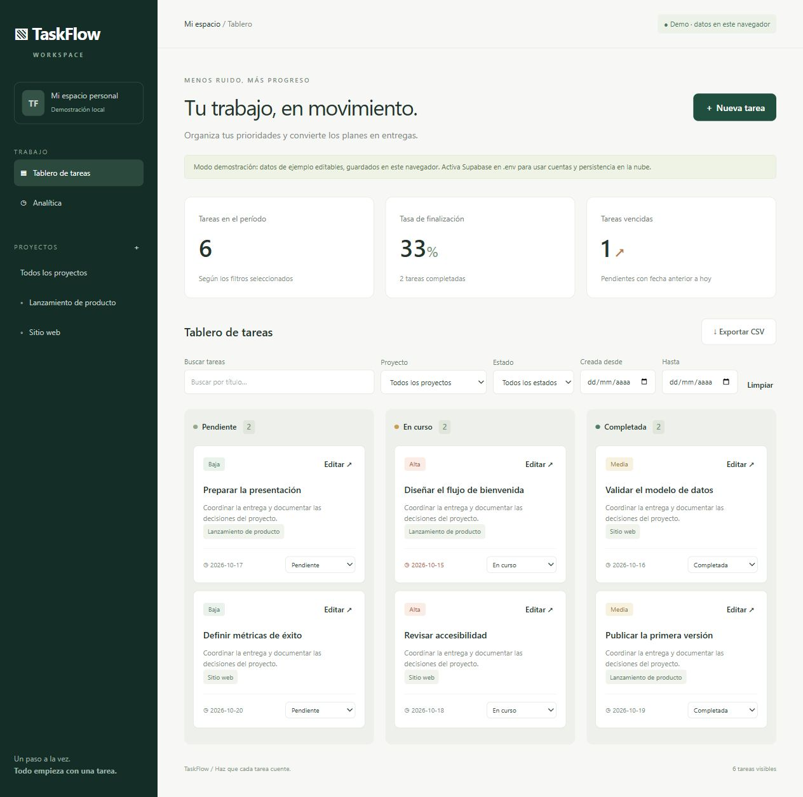
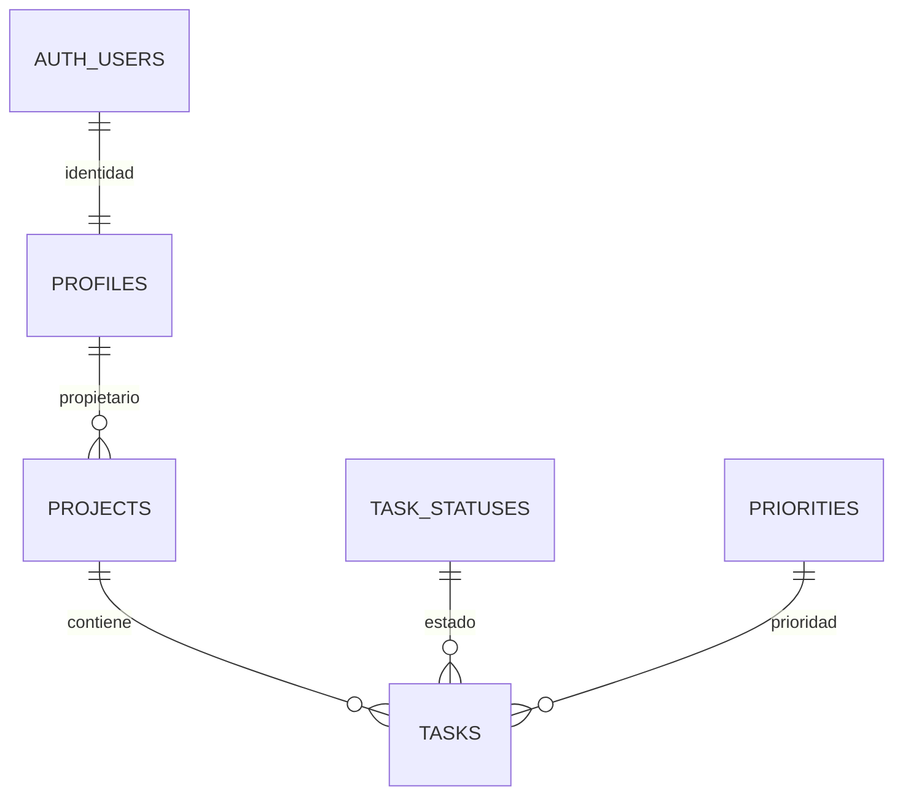

# TaskFlow

Gestor de proyectos y tareas para estudiantes y equipos pequeños que necesitan visualizar sus prioridades. Cada cuenta dispone de un espacio personal privado; el equipo de desarrollo trabaja sobre el repositorio con GitFlow.

**Entrega basada en Proyecto Práctico.pdf.** React + Vite + Tailwind CSS, Supabase Auth (JWT) y PostgreSQL. Incluye modo demo persistente en el navegador para presentar sin credenciales.



## Inicio rápido (demostración)
Entorno verificado: Node.js 24.19.0 (fijado en .nvmrc y .node-version) y npm; mínimo compatible Node.js >=22.12. Desde la carpeta taskflow:
```sh
npm ci
npm run dev
```
Abre la dirección que imprime Vite, normalmente http://127.0.0.1:5173. Sin .env se usa demo. Puedes crear proyectos/tareas, editar tareas, cambiar estado, eliminar, buscar, filtrar, ver analítica y exportar CSV. Los datos demo son sintéticos y permanecen únicamente en este navegador. Borrar la clave localStorage taskflow-demo-v1 restablece la muestra. No se migra demo a la nube.

## Activar Supabase real
1. El proyecto TaskFlow de esta entrega ya está configurado (ver docs/CLOUD.md). Para una instalación nueva, crea un proyecto Supabase y espera a que esté disponible. En SQL Editor ejecuta una sola vez `supabase/migrations/001_initial.sql`. No repetir sobre una instalación existente; cambios posteriores necesitan nueva migración.
2. Copia `.env.example` a `.env` (`Copy-Item .env.example .env` en PowerShell, `cp .env.example .env` en macOS/Linux).
3. Pon VITE_DATA_MODE=supabase, VITE_SUPABASE_URL con la URL de tu proyecto y VITE_SUPABASE_PUBLISHABLE_KEY con la clave pública publishable o anon heredada. Nunca uses service_role ni claves secretas en variables VITE: se incorporan al navegador.
4. En Authentication → URL Configuration configura Site URL y redirecciones permitidas para http://127.0.0.1:5173 y la URL real de producción. Si usas localhost, autoriza también ese origen. En Providers habilita Email/password. Mantén confirmación de correo y configura SMTP propio para una entrega confiable si el servicio limita envíos.
5. Reinicia `npm run dev`. Regístrate con correo real, confirma el correo e inicia sesión. Una cuenta nueva empieza sin proyectos: crea uno y después sus tareas. El trigger crea su perfil.
6. Prueba con dos cuentas: ninguna debe ver tareas de la otra. El SDK envía JWT y Supabase valida cada acceso; RLS verifica el propietario del proyecto en cada operación y evita referencias a proyectos ajenos. No existe un backend propio que requiera otra clave.

La aplicación incluye registro, inicio y cierre de sesión; no incluye recuperación de contraseña, invitaciones ni colaboración sobre un proyecto. Se recomienda usar cuentas de demostración sin información sensible al presentar.

## Verificación y build
```sh
npm test
npm run test:database
npm run build
npm run preview
```
Pruebas de reglas, KPIs, CSV y flujo de interfaz. `npm run test:database` ejecuta la migración completa en PostgreSQL local mediante PGlite y verifica 31 condiciones de RLS, claves foráneas, triggers y borrado en cascada. Solo se simula la identidad auth.uid(): no prueba la emisión ni validación de JWT, los correos ni la API de Supabase cloud. Para verificar RLS contra TU Supabase: crea dos cuentas confirmadas, completa las variables TEST_* en .env y ejecuta:
```sh
node --env-file=.env scripts/test-rls.mjs
```
La prueba crea proyectos temporales, comprueba aislamiento y los elimina al terminar. No requiere service_role. El resultado local de esta entrega está en docs/VALIDATION.md. CI ejecuta tests de interfaz, PostgreSQL/RLS y build en PRs y main/develop. La activación efectiva y el resultado remoto se registran por separado.
El build dist puede alojarse en un servicio estático; configura variables de entorno al construir, HTTPS en producción y redirecciones de Auth. Este paquete no está publicado.

## Estructura
```text
src/                         interfaz, repositorio demo/Supabase y reglas
supabase/migrations/         modelo, índices, triggers, RLS y vista analítica
tests/                       reglas y flujo de UI
scripts/                     pruebas PostgreSQL/RLS, Supabase cloud y lanzador OpenCode
.opencode/agents/            arquitecto, frontend, backend, QA y analítica
.opencode/skills/            cinco skills locales del proyecto
analytics/                   dataset ejemplo y receta de Looker Studio
docs/                        arquitectura, GitFlow, presentación y validación
.github/                     CI y plantilla de PR
```

## OpenCode: entorno homogéneo
OpenCode 1.19.3 está fijado en las dependencias y el lockfile. `npm ci` instala exactamente esa versión. Ejecuta `npm run opencode -- --version`, `npm run opencode -- agent list` y `npm run opencode` desde la raíz. [Guía y evidencia de instalación](docs/OPENCODE.md). La configuración compartida está en opencode.json, las instrucciones en AGENTS.md y los agentes/skills en .opencode. Las credenciales personales de modelo y logs quedan en .local/opencode, ignorado por Git.

| Agente | Skill | Responsabilidad |
|---|---|---|
| architect | taskflow-architecture | decisiones y modelo ER |
| frontend | taskflow-frontend | React, Tailwind y accesibilidad |
| backend | taskflow-supabase | JWT, SQL, índices y RLS |
| qa | taskflow-quality | tests y verificación externa |
| analytics | taskflow-analytics | KPIs y dashboard |

En OpenCode usa @architect, @frontend, @backend, @qa o @analytics con una tarea acotada. Cada agente carga su skill. Propuesta de sesión: @backend revisa la relación proyecto/propietario y ejecuta la prueba RLS con cuentas de prueba. Guarda evidencia real en docs/TEAM.md. Se ejecutaron la CLI y el descubrimiento de agentes; se ejecutó una revisión real del agente qa con el modelo gratuito opencode/glm-5.3-flash-free y su skill; ver [evidencia](docs/OPENCODE_QA.md).
MCP es opcional según el PDF y no se configura: SQL Editor, SDK y archivos versionados cubren el flujo sin acceso adicional. Si se añade un MCP de Supabase, usar proyecto de desarrollo, OAuth/permisos mínimos y registrar su justificación, sin tokens en Git.

## Datos, GitFlow y dashboard
Modalidad individual autorizada por el profesor, según confirmación del estudiante. [Correspondencia completa con los requisitos y evidencia](docs/CUMPLIMIENTO.md). [Enlaces preparados para Classroom](ENTREGA.md).



| Tabla | Claves y campos principales | Propósito |
|---|---|---|
| profiles | id UUID PK/FK auth.users, display_name, created_at | Perfil privado creado al registrarse |
| projects | id UUID PK, owner_id FK profiles, name, description, created_at | Proyecto de una cuenta |
| tasks | id UUID PK, project_id FK projects, title, description, status FK, priority FK, due_date, created_at, updated_at, completed_at | Tarea; propietario derivado del proyecto |
| task_statuses | id TEXT PK, label UNIQUE | Catálogo de estados |
| priorities | id TEXT PK, label UNIQUE | Catálogo de prioridades |
| task_analytics | Vista security_invoker | Dataset analítico que conserva RLS |

Modelo ER, diccionario y seguridad: [docs/ARCHITECTURE.md](docs/ARCHITECTURE.md).
Ramas main, develop, feature/*, release/* y hotfix/*, PRs y revisiones: [docs/GITFLOW.md](docs/GITFLOW.md).
Tres KPIs, gráficos temporal/comparativo/distribución y filtros: [analytics/README.md](analytics/README.md).
Guion y requisitos de entrega: [docs/PRESENTATION.md](docs/PRESENTATION.md).

**Repositorio GitHub:** https://github.com/StivenR1128/Proyecto-Pr-ctico — compartir acceso con el docente si es privado.
**Dashboard Looker Studio:** https://datastudio.google.com/u/1/reporting/281c1997-00c3-4873-bb45-5c6b59fbeb8d/page/SKVBG — reporte real con gráficos verificados en Chrome y filtros comprobados; lectura mediante enlace autorizada y habilitada. [Estado cloud verificado](docs/CLOUD.md).
El repositorio y el reporte son reales y están accesibles mediante enlace. La entrega de ambos enlaces en Classroom no se ha realizado desde esta sesión. El historial de colaboración y las revisiones deben corresponder a trabajo real del equipo.

## Referencias técnicas
- https://supabase.com/docs/guides/database/postgres/row-level-security
- https://supabase.com/docs/guides/database/views
- https://opencode.ai/docs/agents/
- https://opencode.ai/docs/skills/
- https://tailwindcss.com/docs/installation/using-vite

No subir .env, contraseñas, tokens, node_modules ni datos privados. package-lock.json fija las versiones instaladas para npm ci.


