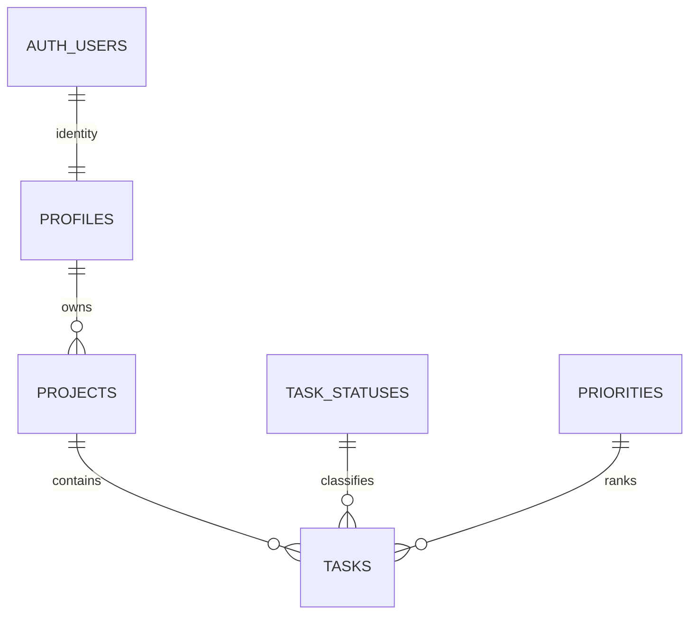

# Arquitectura y diccionario

Aplicación SPA React → SDK Supabase → Auth (JWT) y API PostgREST → PostgreSQL con RLS.
El SDK adjunta el access token y gestiona su renovación; Supabase valida JWT en cada petición.
La interfaz solo monta recursos privados cuando existe sesión. La barrera real es RLS, incluso ante peticiones directas.
Cada cuenta administra sus propios proyectos y tareas. No hay espacios compartidos ni asignación a terceros.
Demo usa localStorage, sin autenticación y sin sincronización con la nube.

| Tabla | Clave y campos | Propósito |
|---|---|---|
| profiles | id UUID FK auth.users; display_name; created_at | Perfil privado creado por trigger |
| projects | id UUID; owner_id FK profiles; name; description; created_at | Proyecto de una cuenta |
| tasks | id UUID; project_id FK projects; title; description; status FK; priority FK; due_date; created_at; updated_at; completed_at | Trabajo dentro de un proyecto |
| task_statuses | id TEXT PK; label UNIQUE | Catálogo de tres estados |
| priorities | id TEXT PK; label UNIQUE | Catálogo de tres prioridades |
| task_analytics | vista con security_invoker | Dataset sin correo ni descripción |

Identidades y catálogos están separados de las entidades operativas; no hay listas ni etiquetas repetidas almacenadas en columnas.
El propietario de cada tarea se deriva del proyecto: no se duplica owner_id en tasks. El modelo separa perfiles, proyectos, tareas y catálogos (3FN), y RLS valida la relación con el propietario mediante EXISTS.
Índices: propietario/fecha, proyecto/estado, proyecto/fecha, claves de catálogo y vencimiento de tareas abiertas.
Los borrados de cuenta y proyecto propagan cascade; la interfaz confirma el borrado de proyectos.
completed_at se fija al completar, se conserva al editar una tarea completada y se limpia al reabrir.
RLS permite CRUD al propietario, lectura de catálogos a authenticated y ningún acceso a anon. La vista respeta RLS.
No se usa service_role en frontend ni un conector SQL que eluda RLS para Looker.

Decisión: no implementar colaboración multiusuario porque no es un requisito del PDF. El equipo colabora sobre el código mediante GitFlow.
